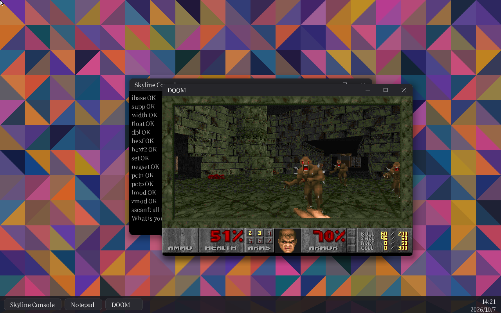

```text
  /$$$$$$  /$$                 /$$ /$$                      /$$$$$$                        /$$
 /$$__  $$| $$                | $$|__/                     /$$__  $$                      | $$
| $$  \__/| $$   /$$ /$$   /$$| $$ /$$ /$$$$$$$   /$$$$$$ | $$  \__/ /$$   /$$  /$$$$$$$ /$$$$$$    /$$$$$$  /$$$$$$/$$$$
|  $$$$$$ | $$  /$$/| $$  | $$| $$| $$| $$__  $$ /$$__  $$|  $$$$$$ | $$  | $$ /$$_____/|_  $$_/   /$$__  $$| $$_  $$_  $$
 \____  $$| $$$$$$/ | $$  | $$| $$| $$| $$  \ $$| $$$$$$$$ \____  $$| $$  | $$|  $$$$$$   | $$    | $$$$$$$$| $$ \ $$ \ $$
 /$$  \ $$| $$_  $$ | $$  | $$| $$| $$| $$  | $$| $$_____/ /$$  \ $$| $$  | $$ \____  $$  | $$ /$$| $$_____/| $$ | $$ | $$
|  $$$$$$/| $$ \  $$|  $$$$$$$| $$| $$| $$  | $$|  $$$$$$$|  $$$$$$/|  $$$$$$$ /$$$$$$$/  |  $$$$/|  $$$$$$$| $$ | $$ | $$
 \______/ |__/  \__/ \____  $$|__/|__/|__/  |__/ \_______/ \______/  \____  $$|_______/    \___/   \_______/|__/ |__/ |__/
                     /$$  | $$                                       /$$  | $$
                    |  $$$$$$/                                      |  $$$$$$/
                     \______/                                        \______/
```
<p align="center">
  
  <br><em>An x86_64 SMP hobby OS with a CPU-parallel software compositor,
  a working window manager, and a private-contract, fully modularized kernel.
  Runs in QEMU (tested with 512 MB – 2 GB guest RAM).</em>
</p>

[](./LICENSES/GPL-2.0-only)
[](./LICENSES/MIT)


[](./docs/kernel-modules.md)

> **SkylineSystem 是一个面向 x86_64 SMP 的 hobby 操作系统：不是 Linux 发行版，也不追求
> POSIX/Linux ABI。** 它在一个架构上追求深度——自研调度器/虚拟内存/系统调用边界/合成器/
> 窗口管理器，并在此基础上实现了**私有契约型可加载内核模块（kmod）**与**全内核组件化**：
> Tier 0 固定核心之外，驱动、文件系统、网络栈、平台组件与 syscall 实现全部是受同一套
> 拓扑/能力/事务/生命周期治理的组件（内建静态链接，可被 `.ko` 接管/热替换）。

> **English TL;DR** — SkylineSystem is a hobby x86_64 SMP OS (not a Linux
> distribution, not POSIX) with an original deadline-based scheduler, a
> CPU-parallel software compositor + window manager, 4-level paging/CoW,
> ext4/lwIP/network stacks, and a **private-contract loadable-kernel-module
> system**: the Tier 0 core is fixed, while 37 built-in components and 15
> `.ko` demos share one topology / capability / transactional-load /
> hot-replace model. Build with `make cm`, run it in QEMU — see §5.

> [!CAUTION]
> 仅在 QEMU 中测试，**不要在真机上运行**（仍处于开发/测试阶段）。

---

## 1. 三层内核架构

内核由三层组成，三者共享同一套组件线格式、拓扑图、能力策略与生命周期治理：

| 层级 | 内容 | 链接方式 | 说明 |
|---|---|---|---|
| **Tier 0** | 启动、GDT/IDT/中断、页表、上下文切换、调度器核心、syscall 入口、模块加载器/治理、能力注册表、klib、内存机制 | 固定，不可模块化 | 系统的可信基座（TCB），见 §1.1 |
| **Tier 1** | 平台/时间/SMP、调度策略、分配策略、设备/PCI、全部驱动、VFS/ext4/FAT/rootfs、lwIP、framebuffer、syscall 实现家族、user.init | 内建组件：静态链接进内核镜像，但使用与 `.ko` **完全相同的** manifest/`.in`/`.out` 线格式、拓扑、能力与生命周期；可被 `.ko` 热替换 | 共 **37 个内建组件**，源码全部位于 `kernel/modules/builtin/` |
| **Tier 2** | 外部可加载实现/扩展/诊断 | 运行时 ET_REL 加载 | **15 个演示 `.ko`** 随 ISO 下发，见 §4 |

一句话概括：**统一边界（syscall/加载器/治理），放开实现（组件私有契约），管住回滚（事务化加载与热替换）**。

### 1.1 模块线格式与治理机制

- **线格式**：`.ko` / 内建组件均声明 `.in`（`{provider 组件名 + 符号 + 私有契约 + 回填地址槽 + ABI 区间}`）、
  `.out`（函数/数据/私有契约 ops/座位/syscall 实现）与 `.kmod_manifest`（256B 清单：
  名称/版本/Tier/flags/能力/生命周期回调/预算）。
- **ET_REL 加载器**：只接受白名单重定位集（`R_X86_64_64/PC32/PLT32/32/32S`），
  对段边界/对齐/manifest/字符串/导入槽做严格校验，未知类型整体拒绝。
- **统一拓扑图**：Kahn 排序 + 依赖环检测，启动时按 provider 先序初始化；
  缺失依赖/环形依赖使整个加载事务失败而非静默乱序。
- **能力策略**：`STRICT`（默认，仅内置可信清单，能力 = 清单∩声明）/`OPEN`/`DISABLED`；
  `KMOD_CAP_RESERVED_CORE` 等 Tier0 保留位对任何 `.ko` 声明即拒绝。
- **事务化**：加载→回填→注册→init 全成功或**逆序全回滚**；init 失败不残留半加载模块。
- **热替换**：quiesce 协作式静默 → epoch 排空 → 看门狗预算 → 原子切换新镜像；
  任一步失败自动回退旧版本（含内建组件被 `.ko` 接管后的回退）。
- **卸载**：引用计数硬门禁（有消费者时 `EBUSY`），卸载后导入边/座位/导出自动撤回。
- **固定 syscall 边界**：0..63 固定契约槽（参数/返回/错误码/语义固定；可替换的是实现），
  128..511 动态命名空间；入口表使用治理哨兵，未注册槽返回 `ENOSYS`。
- **座位（Seat）**：开放策略、不开放机制。已落地 `kernel.seat.random.v1`（随机源）、
  `kernel.seat.sched.policy.v1`（调度策略）、`kernel.seat.alloc.policy.v1`（分配策略，
  large-alloc/OOM 冷路径），默认实现与旧行为逐位等价。
- **Tier0 共享服务**：klib 公共工具以两种方式共享给**每个模块**：
  ① C 链接函数（`strlen/strcmp/snprintf_/hashmap_*/art_*/spinlock_*`、`kcalloc/krealloc/
  kmalloc_aligned` 等）作为 `.kout` 直接导出符号，`.ko` 直接调用即可由加载器解析；
  ② 版本化 ops 契约 `kernel.klib.v1`、`kernel.sync.v1`、`kernel.algo.v1`，带
  contract/ABI/结构尺寸强校验。当前内核共 **57 项导出**。

### 1.2 组件化范围（Tier 1，37 个内建组件）

| 类别 | 组件 |
|---|---|
| 平台/时间 | `kernel.arch.acpi`、`arch.apic`、**`arch.irq`**、`arch.smp`、`time.pit`、`time.hpet`、`time.rtc`、`fs.cache` |
| 调度/分配 | `kernel.sched.core`、`sched.install`、**`sched.policy.eevdf`**（策略座位）、**`alloc.policy`**（分配座位） |
| 设备/PCI/块 | `kernel.dev.core`、`pci.core`、`pci.enumerate`、`block.core` |
| 驱动 | `driver.ahci`、`nvme`、`xhci`、`e1000`、`input.ps2.kbd`、`input.ps2.mouse` |
| 文件系统 | `fs.vfs`、`fs.ext4`（lwext4）、`fs.fatfs`、`fs.rootfs` |
| 网络 | `net.netdev`（设备注册表）、`net.lwip`（协议栈 deferred 线程） |
| 显示/用户态 | `display.fb`、`user.init`（desktop/hw 进程创建） |
| syscall 实现 | `syscall.{file,proc,mem,info,time,dev,random}`（27 个固定槽注册；入口/语义固定） |

### 1.3 启动流程（拓扑驱动）

```text
[Tier 0] cli → Serial → SSE/GDT/IDT/FPU → PMM → VMM → SLAB/SLUB
         → SIMD → SMEP/SMAP → syscall_init（固定入口/治理哨兵）→ KmodInit
         ↓
[Tier 1] KmodBootComponents：扫描 .kbuiltin.desc → Kahn 拓扑排序 → bind/apply/init
         （ACPI→APIC→PIT/HPET/RTC→SMP→sched→PCI→驱动→VFS/ext4→rootfs
          →fb→sched.install→syscall 家族→net/display/user.init）
         ↓
[Tier 2] KmodBootIngest（登记 ISO 内全部 .ko）→ KmodBootLoad（KMOD_MF_BOOT 模块）
         ↓
sti 前单线程 KMOD_SELFTEST（12 个用例，含加载/回滚/热替换/座位/共享服务）
         ↓
sti + SCHED_VEC IPI → 调度器接管 → 桌面/DOOM/lwIP
```

串口实测片段：

```text
[kmod] builtin components: 37 declared
[kmod] builtin graph: 37 component(s) ready (topo order)
[kmod] kernel exports: 57 symbol(s) published
[kmod] boot load: 2 requested, 2 ready, 0 failed
KMOD_SELFTEST PASS 12/12
[user.init] desktop PROCESS: 6
```

---

## 2. 目录结构

```
SkylineSystem/
├── kernel/
│   ├── src/                    # 仅 Tier 0 固定核心
│   │   ├── arch/<arch>/        #   start/init、interrupt、vmm、cpu、simd、
│   │   │                       #   schedule 核心 + syscall 入口、kmod 加载/治理/服务
│   │   ├── mem/                #   PMM / SLAB / SLUB / heap 机制
│   │   ├── klib/               #   kprintf/serial/stallwatch/字符串/ART/hashmap/…
│   │   ├── elf/ flanterm/ print/
│   │   └── main.cpp
│   ├── modules/                # 全部组件实现（全模块化重构后）
│   │   ├── builtin/common/     #   acpi / drivers / fs / net / partition / smbios
│   │   ├── builtin/x86_64/     #   components/（37 个组件壳，按 13 类分子目录）、
│   │   │                       #   dev / drivers / lapic / ioapic / pit / rtc / smp / syscall
│   │   └── loadable/           #   15 个可加载 .ko 演示源码
│   ├── include/kmod/           #   ABI / manifest / 组件宏 / 契约 / 共享服务头
│   ├── bin-x86_64/             #   构建产物：kernel + modules/*.ko
│   └── Makefile                #   模块树递归发现 + .ko 独立构建
├── programs/                   # 用户态：desktop（WM+合成器）、helloworld、PureDOOM…
├── lib/                        # 用户态 libc / 图形库
├── ablib/                      # 高频 libc 原语（memops/AVX 分发）+ freestanding 头
├── tests/                      # 宿主测试套件（含 tests/kmod 模块/组件门禁）
├── docs/                       # 设计文档（见 §6）
├── res/                        # limine.conf、SAF 打包、QEMU/测试脚本
├── limine-protocol/ limine-binary/   # 引导协议与预编译 Limine
├── disk.img                    # 用户程序 ext4 镜像（desktop/DOOM 等）
└── Makefile                    # 顶层构建：ISO / HDD / run / clean / cm
```

> **全模块化约定**：`kernel/src` 只允许放 Tier 0；新增组件实现放到
> `kernel/modules/builtin/{common,<arch>}/`，并在 `components/` 下增加一个
> `KCOMPONENT_BEGIN/END` 壳。头文件暂集中 `kernel/include`（组件私有头下沉到
> modules 树是后续路线图项）。

---

## 3. 核心特性

### 3.1 调度器：EEVDF + RIP 反馈（如实描述）

每 CPU 一棵按**虚拟 deadline** 组织的红黑树（`min_vruntime_subtree` 增强 + 预取提示），
加权时间片、动态基础 quantum 与 SMP push/steal 负载均衡。在此之上，**RIP 反馈**在
定时器 tick 间采样线程 RIP 进度，经 Q10 定点双通道 EWMA（死区 + 滞回）得到快/慢乘子，
用于**拉长或缩短抢占 quantum**——忙等线程被更频繁打断，有进展线程获得更长连续运行。

**它不改变 CPU 份额**：反馈不进入 `Pick()`，vruntime 按真实流逝时间计费，虚拟 deadline
是 `vruntime + const`。所以它塑造的是**中断延迟**，不是公平份额；目前也**没有量化基准**，
`sched_bench` 只验证 EWMA 收敛。详见 [docs/scheduler.md](docs/scheduler.md)。

### 3.2 GUI：CPU 并行软件合成器 + 窗口管理器

- **N 条带、N−1 个 worker**：主线程渲染条带 0，其余每 CPU 一个 worker 并绑定内核；
  全部渲染到离屏 back buffer，只有主线程提交扫描输出。
- **双缓冲单提交点**、**脏矩形比较后 blit**：静态场景除光标外零扫描输出写入。
- **分层链表**：每窗口每条带一次裁剪判断，逐扫描线 blit；每帧 O(条带数 × 窗口数)。
- **WM 拥有窗口装饰**：SDF 抗锯齿圆角、方向性软阴影、拖动、最大化、最小化、
  8 方向缩放；关闭按钮经 `sys_kill` **真正终止客户端进程**。
- **独立光标层**：O(16²) 直写扫描输出，移动鼠标不触发整帧重组。
- 文本：in-tree TTF 光栅器（基于 stb_truetype，LRU+哈希 glyph 缓存，CJK 排版）
  与 flanterm 控制台渲染器（均为第三方组件）。

已知缺口：子进程退出依赖周期轮询探测；无 z-order/focus 管理；最小化会丢失最大化状态。
详见 [docs/gui.md](docs/gui.md)。

### 3.3 内存与安全

- **VMM**：4 级页表（5 级代码路径存在但编译关闭）、1 GB / 2 MB 大页、写时复制
  （2 MB CoW 整页复制；1 GB 页可分裂到 2 MB）、VMA、批量 TLB shootdown、W^X。
- **PMM**：位图帧分配器 + 每 CPU 页缓存；内核堆 SLUB/SLAB（每 CPU magazine + 双重释放检测）。
- **用户态分配器**：epoch-QSBR 延迟回收。
- **加固**：bootloader 提供 KASLR slide、SMEP、SMAP、EFER.NXE、独立地址空间、
  引用计数共享内存授权、用户态 W^X。

### 3.4 I/O、文件系统与网络

- **驱动**：PS/2 键鼠、framebuffer、AHCI、NVMe、USB（xHCI + MSC/HID）、e1000（82574L）。
- **文件系统**：VFS + SAF + lwext4（ext4）；**FAT 目前仅部分接线**；ATA/ATAPI 为未注册死代码。
- **网络**：e1000 + lwIP 已接线：DHCP、ICMP ping、UDP/TCP 收发（QEMU slirp）；
  见 [docs/network.md](docs/network.md)。
- **用户态**：自有 libc/`printf`、ELF 加载器、线程 + TLS、共享内存；`programs/` 内
  自带桌面、终端、PureDOOM 等。

### 3.5 工具链与构建

- Freestanding C/C++，Clang target `x86_64-unknown-none` + `ld.lld`；传统 Makefile。
- 内核使用 `-Wall -Wextra`；用户态 `lib/` 使用 `-Wall -Wextra -Werror`。
- 单一 Limine 镜像（BIOS + UEFI），同时可生成 HDD 镜像；`.ko` 由独立 `modules` 目标构建，
  默认不进入内核链接。

---

## 4. 可加载模块（Tier 2）演示

`kernel/modules/loadable/` 下 15 个 `.ko` 演示，随 ISO 下发到 `boot():/boot/modules/`：

| 模块族 | 演示内容 |
|---|---|
| `vendor.demo.hello` / `greeter` | 模块级依赖 + 私有契约：greeter 导入 hello 的导出函数，拓扑先序加载 |
| `vendor.demo.prng` / `seat` | 随机源座位提供者：加载接管 `sys_getrandom`，失败/卸载回退 Tier0 |
| `vendor.demo.sched` | 调度策略座位：`kernel.seat.sched.policy.v1` 的 v1→v2 原子热替换 |
| `vendor.demo.alloc` | 分配策略座位：large-alloc 阈值/OOM 决策冷路径策略热替换 |
| `vendor.demo.syscall` | 动态 syscall 槽注册 + 固定探针槽实现覆写，热替换与卸载清除 |
| `vendor.demo.klib` | Tier0 共享服务消费者：直接符号（strlen/strcmp/snprintf_）+ `kernel.klib.v1`/`kernel.sync.v1` ops |
| `badinit` / `badcap` / `cycle_a/b` | 负向：init 失败事务回滚、能力拒绝、依赖环拒绝 |

模块作者最小示例：

```c
#include <kmod/kmod_module.h>

KMOD_IMPORT_FN(kprintf_, int, (const char *, ...), "kernel", "kprintf_", "kernel.log.v1");
KMOD_IMPORT_KLIB(klib);          /* 或直接 extern "C" 调用 strlen/snprintf_ 等直接符号 */

static int32_t my_init(void)
{
    char buf[32];
    klib->snprintf_(buf, sizeof(buf), "strlen=%u", (unsigned)klib->strlen("x"));
    kprintf_("hello .ko: %s\n", buf);
    return KMOD_OK;
}
static void my_exit(void) {}

KMOD_EXPORT_FN(my_fn, "vendor.me.v1", 1);
KMOD_MANIFEST("vendor.demo.me", "1.0.0", KMOD_TIER_IMPL,
              KMOD_MF_BOOT | KMOD_MF_UNLOADABLE, KMOD_CAP_LOG,
              my_init, my_exit);
```

构建：`make -C kernel modules`；契约/重定位自检：`make -C kernel modules-check`。
ABI、加载器、拓扑、治理、热替换、座位与共享服务的完整设计见
[docs/kernel-modules.md](docs/kernel-modules.md)，组件清单与迁移状态见
[docs/kernel-components.md](docs/kernel-components.md)。

---

## 5. 快速开始

### 5.1 环境（Ubuntu / WSL Ubuntu-24.04）

```bash
sudo apt-get update
sudo apt-get install -y git make curl clang lld nasm xorriso \
    qemu-system-x86 qemu-utils e2fsprogs mtools e2tools dos2unix
```

> 只需 x86_64 宿主；内核默认工具链为 `clang` / `clang++` / `ld.lld`
> （可在命令行覆盖 `KCC=`/`KCXX=`/`KLD=`）。首次构建会通过 `kernel/get-deps`
> 与 Limine 下载脚本拉取第三方源码/预编译引导器。

### 5.2 构建

```bash
# 完整构建（清理 + 依赖 + SAF 用户态 + disk.img + 内核 + .ko + ISO）
make cm

# 或增量构建（内核 + .ko + ISO，复用已生成的 disk.img/programs.saf）
make SkylineSystem-x86_64.iso -j4

# 只构建/检查 .ko
make -C kernel modules-check          # 15/15 [OK]
```

产物：

- `SkylineSystem-x86_64.iso` — BIOS + UEFI 可引导 ISO（内核 + `.ko` + `programs.saf`）
- `SkylineSystem-x86_64.hdd` — 可选 HDD 镜像：`make all-hdd`
- `kernel/bin-x86_64/modules/*.ko` — 15 个可加载模块
- `disk.img` — 用户程序 ext4 镜像（desktop/DOOM 等）；已存在时 `make cm` 不会重建，
  需要全新文件系统请手动删除。

> [!NOTE]
> 直接 `cd kernel && make` 时必须显式传 `SS_BUILD_DIR`：
> `cd kernel && make SS_BUILD_DIR="$(cd .. && pwd)"`（顶层 Makefile 会自动处理）。

### 5.3 运行

```bash
# UEFI（自动下载 OVMF）；默认 QEMU 参数 -m 2G -smp 4，可加 QEMUFLAGS="-m 4G -smp 8"
make run

# BIOS
make run-bios

# 或手动运行（含用户程序磁盘与 slirp 网络）
qemu-system-x86_64 -machine q35 -cpu max -m 2G -smp 4 \
  -cdrom SkylineSystem-x86_64.iso \
  -serial stdio -net nic -net user \
  -drive file=disk.img,if=none,id=drive0,format=raw \
  -device ide-hd,drive=drive0,bus=ide.0
```

Windows 侧可直接使用 `res/scripts/0run-x86_64.bat` / `0run-aarch64.bat` 等脚本，
或安装 QEMU 后用 `qemu-system-x86_64.exe` 加载 ISO。

### 5.4 调试

```bash
# 非 KASLR 调试构建（GDB 地址 = 链接地址）
cd kernel && make SS_BUILD_DIR="$(cd .. && pwd)" DEBUG=1

# 手动 QEMU 加 -s（gdbstub :1234）；然后用 gdb 连接
gdb kernel/bin-x86_64/kernel
(gdb) target remote :1234
```

---

## 6. 测试与门禁

### 6.1 宿主测试（无需 QEMU）

```bash
cd tests
make -B kmod && ./bin/kmod_test          # 模块/组件门禁：PASS 6/6
make -B kmod-asan && ./bin/kmod_test_asan  # ASAN+UBSAN 负向/fuzz：0 报告

make -B slub slub-poison fc fc-reg sched slub-mt fc-mt   # 其余内核子系统套件
bash ../res/scripts/test/ci.sh           # 全套 CI
bash ../res/scripts/test/golden.sh       # 与金样逐行比对
```

`tests/kmod` 覆盖：ELF 加载器正/负向 + 2000 次 fuzz、拓扑 DAG/环、能力策略、
syscall 注册表/座位、事务回滚、内建组件模型，以及 **kernel 导入的 contract/ABI/size
强校验**与 **klib 直接符号解析**。

### 6.2 QEMU 串口门禁（Windows PowerShell）

```powershell
pwsh -File res/scripts/test/kmod_smoke.ps1 `
     -Root C:\ZSY\SkylineSystem -WaitSeconds 200 -MinBuiltins 30
```

期望：`KMOD SMOKE: PASS`，串口包含 `KMOD_SELFTEST PASS 12/12`、
`builtin ready` ×37、`kernel exports: 57 symbol(s)`、桌面 `PROCESS: 6`，且无异常/STALL。
GitHub Actions 的 `.github/workflows/ci.yml` 已接入宿主套件、kmod/ASAN、静态分析与金样门禁。

### 6.3 构建门禁速查

```bash
make -C kernel modules-check             # .ko 段/重定位白名单
cd kernel && make kaslr-check            # KASLR 32 位重定位清零检查
readelf -r kernel/bin-x86_64/kernel | grep 32S   # 应为空
```

---

## 7. 文档

完整文档索引见 [docs/README.md](docs/README.md)。常用入口：

| 文档 | 内容 |
|---|---|
| [kernel-modules.md](docs/kernel-modules.md) | kmod ABI、ET_REL 加载器、拓扑图、能力、事务加载/回滚、热替换、席位、Tier0 共享服务 |
| [kernel-components.md](docs/kernel-components.md) | 全内核组件化台账：Tier 划分、内建组件线格式、启动映射、契约清单、迁移状态与路线图 |
| [architecture.md](docs/architecture.md) | 分层、目录、启动序列（Tier0 + 组件拓扑） |
| [scheduler.md](docs/scheduler.md) | EEVDF + RIP 反馈调度器（含"它不做什么"说明） |
| [memory.md](docs/memory.md) | 4 级页表、大页、CoW、SLUB、TLB shootdown、W^X |
| [smp.md](docs/smp.md) | AP bring-up、per-CPU、GS base、XSave、SMAP/SMEP |
| [syscall.md](docs/syscall.md) | 非 POSIX syscall ABI 参考 |
| [gui.md](docs/gui.md) | 并行软件合成器、窗口层、光标层、SDF 圆角/阴影与已知缺陷 |
| [filesystems.md](docs/filesystems.md) | VFS / SAF / lwext4 / FAT / 每 CPU 文件缓存 |
| [network.md](docs/network.md) | e1000 驱动 + lwIP 移植、DHCP/ping/TCP 与边界 |
| [stability-report.md](docs/stability-report.md) · [stability-audit.md](docs/stability-audit.md) | 长稳运行报告与稳定性审计 |
| [../SECURITY.md](SECURITY.md) | 安全状态、明确边界、已知风险与漏洞上报流程 |

---

## 8. 设计原则

| 原则 | 在 SkylineSystem 中的含义 |
|---|---|
| **边界固定、实现开放** | syscall 对外契约固定；内部组件以私有契约自治（`vendor.*` 命名空间）；内核只做加载/治理/回滚，不做业务接口胶水 |
| **机制与策略分离** | 调度器/分配器/VFS/syscall 入口等机制固定在 Tier 0；策略/实现以组件或座位形式可替换 |
| **先深度后广度** | 只把 x86_64 做深；其他架构仅有构建配置，移植尚未实现 |
| **诚实工程** | 文档明确写出"没做什么"与已知风险（无内存隔离、协作式 quiesce、FAT stub、组件化路线图等） |
| **Built from source** | 第三方组件（lwIP/FatFs/lwext4/flanterm/SAF/libart/hashmap/printf/x86mem/stb_truetype）均保留许可与来源说明 |

---

## 9. 已知限制与边界

1. **仅 QEMU 验证**：未在真机运行；测试内存 512 MB – 2 GB，默认 2 GB / 4 vCPU。
2. **仅 x86_64**：aarch64/riscv64/loongarch64 只有构建配置，未实现。
3. **无 POSIX/Linux ABI**：系统调用、libc 均为自有语义；不要期望 Linux 二进制兼容。
4. **kmod 无内存隔离**：模块与内核同地址空间（与 Linux 内核模块同一信任级）；
   能力位/拓扑/事务/看门狗是治理边界，不是安全沙箱。quiesce 为协作式，错误模块可绕过。
5. **组件化仍在收敛**：FAT 仅基础接线、ATA/ATAPI 未注册；`kernel.netdev.v1` 已导出但
   e1000/lwIP 胶水仍直接调用；`kernel.input.v1` 为草案；分配策略仅接冷路径。
   头文件暂集中 `kernel/include`，组件私有头下沉到 modules 树列入路线图。
6. **既有并发风险（pre-existing）**：文件缓存的 `file_cache_tick` 在 PIT IRQ 上下文
   持锁做较重工作，与 VMM/heap 锁存在跨核 AB-BA 窗口；kmod 自检已移到 sti 前单线程
   以降低触发概率，根治方向记录在 [kernel-components.md §11](docs/kernel-components.md)。
7. **GUI 缺口**：无 z-order/focus 管理、最小化丢失最大化状态、子进程退出靠轮询。
8. **调度器 RIP 反馈无量化基准**：只验证 EWMA 收敛，不宣称性能收益。

---

## 10. License

[](./LICENSES/GPL-2.0-only)
[](./LICENSES/MIT)
[](https://www.gnu.org/licenses/gcc-exception-3.1.html)

* **`kernel/`**：GPL-2.0-only（copyleft；分发修改后的内核二进制须提供完整修改源码）
* **`lib/`、`programs/`、`ablib/atomic/`**：MIT
* **`ablib/freestndchdrs/`**：GPL-3.0-or-later **WITH GCC-exception-3.1**
  （可链接进独立/闭源程序，见该目录 `COPYING3.RUNTIME`）
* 内核与用户态运行在独立地址空间，仅通过 syscall 通信；按 FSF 指引，MIT 用户态代码
  不构成 GPL 内核的衍生作品，无 copyleft 传染。

SPDX 头正在逐步补齐（当前覆盖率约 51%，尚未完全满足 REUSE）；详见 `LICENSES/`、
根 [LICENSE](LICENSE) 与逐文件 SPDX 标签。

> [!NOTE]
> 内核内 vendored 的第三方代码包括 lwIP、FatFs、lwext4、flanterm、SAF、
> 改编版 libart / tidwall hashmap、**mpaland/printf**、**x86mem** memops 与
> stb_truetype 衍生光栅器；其许可（BSD-3 / BSD-2 / FatFs-license / MIT 等）
> 已在源文件中保留。

---

## 11. Thanks to

* [MaslOS](https://github.com/marceldobehere/MaslOS)
* [VisualOS](https://github.com/nothotscott/VisualOS)
* [MicroOS](https://github.com/Glowman554/MicroOS)
* [MaslOS-2](https://github.com/marceldobehere/MaslOS-2/)
* [HanOS](https://github.com/jjwang/HanOS/)
* [SAF](https://github.com/chocabloc/saf)

## 12. Main Contributors

* [Yo-yo-ooo](https://github.com/Yo-yo-ooo/)
* [marceldobehere](https://github.com/marceldobehere)
* [Arty3](https://github.com/Arty3)
* Renzaoren（QQ）

## 13. Connect

**E-mail: <1218849168@qq.com>**

如果构建失败，请先确认依赖齐全并附上 `make` 输出开 issue；欢迎讨论内核架构与模块治理设计。
