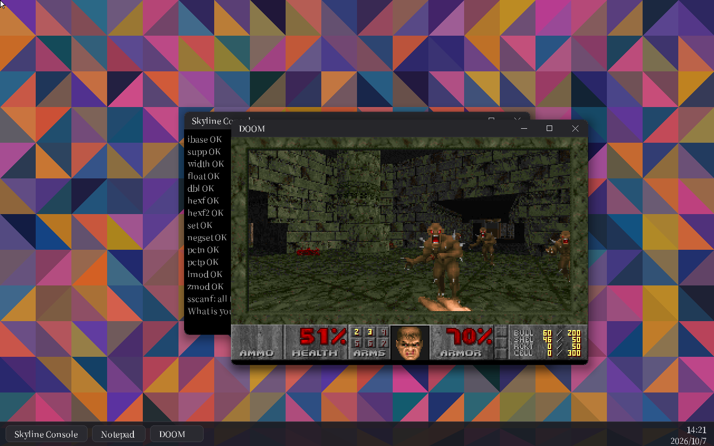

```text
  /$$$$$$  /$$                 /$$ /$$                      /$$$$$$                        /$$
 /$$__  $$| $$                | $$|__/                     /$$__  $$                      | $$
| $$  \__/| $$   /$$ /$$   /$$| $$ /$$ /$$$$$$$   /$$$$$$ | $$  \__/ /$$   /$$  /$$$$$$$ /$$$$$$    /$$$$$$  /$$$$$$/$$$$
|  $$$$$$ | $$  /$$/| $$  | $$| $$| $$| $$__  $$ /$$__  $$|  $$$$$$ | $$  | $$ /$$_____/|_  $$_/   /$$__  $$| $$_  $$_  $$
 \____  $$| $$$$$$/ | $$  | $$| $$| $$| $$  \ $$| $$$$$$$$ \____  $$| $$  | $$|  $$$$$$   | $$    | $$$$$$$$| $$ \ $$ \ $$
 /$$  \ $$| $$_  $$ | $$  | $$| $$| $$| $$  | $$| $$_____/ /$$  \ $$| $$  | $$ \____  $$  | $$ /$$| $$_____/| $$ | $$ | $$
|  $$$$$$/| $$ \  $$|  $$$$$$$| $$| $$| $$  | $$|  $$$$$$$|  $$$$$$/|  $$$$$$$ /$$$$$$$/  |  $$$$/|  $$$$$$$| $$ | $$ | $$
 \______/ |__/  \__/ \____  $$|__/|__/|__/  |__/ \_______/ \______/  \____  $$|_______/    \___/   \_______/|__/ |__/ |__/
                     /$$  | $$                                       /$$  | $$
                    |  $$$$$$/                                      |  $$$$$$/
                     \______/                                        \______/
```
<p align="center">
  
  <br><em>A hobby x86_64 SMP OS: CPU-parallel software compositor, window
  manager, and a kernel assembled from private-contract loadable modules.
  QEMU only, tested between 512 MB and 2 GB of guest RAM.</em>
</p>

[](./LICENSES/GPL-2.0-only)
[](./LICENSES/MIT)


[](./docs/kernel-modules.md)
[](./docs/lua-desktop.md)

> SkylineSystem 是个 x86_64 SMP 的业余系统，既不是 Linux 发行版，也没打算兼容
> POSIX/Linux ABI。调度器、虚拟内存、syscall 边界、合成器、窗口管理器都是自己写的。
> 在这之上做了私有契约的可加载内核模块（kmod），并把内核拆成组件：Tier 0 固定核心之外，
> 驱动、文件系统、网络栈、平台组件、syscall 实现都由同一套拓扑/能力/事务/生命周期治理，
> 内建时静态链接，运行时可以被 `.ko` 接管或热替换。

> English TL;DR — SkylineSystem 是个业余的 x86_64 SMP 系统（不是 Linux 发行版，也不兼容
> POSIX），自带 deadline 调度器、CPU 并行软件合成器 + 窗口管理器、4 级页表与 CoW、
> ext4 与 lwIP 网络栈，以及一套私有契约的动态内核模块：Tier 0 固定，40 个组件
> `.ko` 与 18 个 demo/扩展 `.ko` 打进一个 modules.saf，共用同一套拓扑 / 能力 /
> 事务加载 / 热替换 / 注入模型。
> 编译用 `make cm`，运行见 §5。

> [!CAUTION]
> 仅在 QEMU 中测试，不要在真机上运行（仍处于开发/测试阶段）。

---

## 1. 两层内核架构：Tier 0 + 统一 DynModule

旧文档里的 Tier 1（内建组件）与 Tier 2（外部 `.ko`）**已经合并成同一个
模块类别 DynModule**；并且**内核镜像里不再有 .kbuiltin 内建组件**。40 个原
组件壳各自编译成独立 `.ko`，与 18 个 demo/扩展 `.ko` 一起打进一个
`modules.saf`，Limine 只加载这一个文件：

| 层级 | 内容 | 镜像 | 说明 |
|---|---|---|---|
| **Tier 0** | 启动、GDT/IDT/中断、页表、上下文切换、调度器核心、syscall 入口、模块加载器/治理、能力注册表、klib、内存机制，以及**尚未迁出的** driver/FS/net/sched 共享实现库 | 固定 | 系统的可信基座（TCB），见 §1.1；未迁实现以 `kernel.component.v1` 导出，已迁实现随组件 `.ko` 走 `.out` 跨模块符号表 |
| **DynModule（relocatable）** | 40 个原组件壳（平台/时间/SMP、调度/分配、设备/PCI、驱动、VFS/ext4/FAT/rootfs、lwIP、framebuffer、syscall 家族、user.init、dosvm）+ 18 个 demo/扩展 | 独立 `.ko`，全部在 **modules.saf** 里 | 同一套 manifest/`.in`/`.out`、拓扑、能力与生命周期；`KdllInject` 可按名/按路径像 DLL 一样注入 |
| **resident 核心节点** | `kernel.mem.pmm/vmm/heap`、`kernel.arch.syscall` | 无代码镜像 | 只是模块表里的核心服务节点，供模块显式注入/解析（dosvm init 即示例） |

分工：边界统一（syscall / 加载器 / 治理），实现放开（组件私有契约），回滚可控
（事务化加载与热替换），注入统一（`kernel.dynlink.v1`），分发统一（一个 SAF）。

- **40 个组件**：源码位于 `kernel/modules/`，用
  `-DKMOD_COMPONENT_AS_KO=1` 编译成 `kernel/bin-x86_64/components/**/*.ko`；
- **18 个 demo/扩展**：源码位于 `kernel/modules/loadable/`；
- 58 个 `.ko` 由 `res/scripts/make_modules_saf.py` 打进
  `kernel/bin-x86_64/modules.saf`；
- **实现文件迁入 .ko**：AHCI/NVMe/xHCI+USB/PS2 键鼠/e1000+lwIP 胶水/ext4(lwext4)/
  syscall.{file,proc,time,mem,random,dev,info}、display.fb、dev.core、block.core、
  fatfs 完整实现、lwIP 协议栈、挂载点表、PCI 名称表、file-cache core、fd 操作、
  ACPI 解析/MADT、RTC、HPET、LAPIC/IOAPIC、sched_bench、fd_manager 核心已从内核镜像移出，清单见
  [docs/module-implementation-migration.md](./docs/module-implementation-migration.md)；
- 详细设计见 [docs/kernel-dynlink.md](./docs/kernel-dynlink.md)。

### 1.1 模块线格式与治理机制

- 线格式：resident / relocatable DynModule 均声明 `.in`（`{provider 组件名 + 符号 + 私有契约 + 回填地址槽 + ABI 区间}`）、
  `.out`（函数/数据/私有契约 ops/座位/syscall 实现）与 `.kmod_manifest`（256B 清单：
  名称/版本/类别/flags/能力/生命周期回调/预算）。
- ET_REL 加载器：只接受白名单重定位集（`R_X86_64_64/PC32/PLT32/32/32S`），
  对段边界/对齐/manifest/字符串/导入槽做严格校验，未知类型整体拒绝。
- **单一 SAF 分发**：Limine 只声明 `boot():/boot/modules.saf`；内核
  `KmodSafIngest` 解析 SAF 并把其中 58 个 `.ko` 登记进镜像池。`kernel.*`
  组件标记 **trusted**：允许保留名、能力按清单授予、注册固定 syscall 槽、
  导出地址可指向 kernel 镜像（`KMOD_EXF_EXTERNAL`）；`vendor.*` 仍走 STRICT。
- 统一拓扑图：Kahn 排序 + 依赖环检测，启动时按 provider 先序初始化；
  缺失依赖/环形依赖使整个加载事务失败而非静默乱序。
- 能力策略：`STRICT`（默认，仅内置可信清单，能力 = 清单∩声明）/`OPEN`/`DISABLED`；
  `KMOD_CAP_RESERVED_CORE` 等 Tier0 保留位对任何 `.ko` 声明即拒绝。
- 事务化：加载→回填→注册→init 全成功或逆序全回滚；init 失败不残留半加载模块。
- 热替换：quiesce 协作式静默 → epoch 排空 → 看门狗预算 → 原子切换新镜像；
  任一步失败自动回退旧版本（trusted 组件 .ko 不允许卸载/同名热替换）。
- 卸载：引用计数硬门禁（有消费者时 `EBUSY`），卸载后导入边/座位/导出自动撤回。
- **统一注入**：`KdllInject(name, PIN)`（LoadLibrary）、`KdllResolve`（GetProcAddress）、
  `KdllEject`（FreeLibrary）、`KdllInjectFile(path)`（按路径注入）；resident 与
  relocatable 走同一条绑定路径。tier 只剩一个 `KMOD_TIER_DYN`，旧线值 2 作为兼容别名。
- 固定 syscall 边界：0..63 固定契约槽（参数/返回/错误码/语义固定；可替换的是实现），
  128..511 动态命名空间；入口表使用治理哨兵，未注册槽返回 `ENOSYS`。
- 座位（Seat）：开放策略、不开放机制。已落地 `kernel.seat.random.v1`（随机源）、
  `kernel.seat.sched.policy.v1`（调度策略）、`kernel.seat.alloc.policy.v1`（分配策略，
  large-alloc/OOM 冷路径），默认实现与旧行为逐位等价。
- Tier0 共享服务：klib 公共工具以两种方式共享给每个模块：
  ① C 链接函数（`strlen/strcmp/snprintf_/hashmap_*/art_*/spinlock_*`、`kcalloc/krealloc/
  kmalloc_aligned` 等）作为 `.kout` 直接导出符号，`.ko` 直接调用即可由加载器解析；
  ② 版本化 ops 契约 `kernel.klib.v1`、`kernel.sync.v1`、`kernel.algo.v1`，带
  contract/ABI/结构尺寸强校验；另有 **197 项 `kernel.component.v1`**
  导出供组件 `.ko` 解析 driver/FS/net/sched 实现符号。当前内核共 260 项导出。

### 1.2 组件化范围（40 个组件 `.ko`）

| 类别 | 组件 |
|---|---|
| 平台/时间 | `kernel.arch.acpi`、`arch.apic`、**`arch.irq`**、`arch.smp`、`time.pit`、`time.hpet`、`time.rtc`、`fs.cache` |
| 调度/分配 | `kernel.sched.core`、`sched.install`、**`sched.policy.eevdf`**（策略座位）、**`alloc.policy`**（分配座位） |
| 设备/PCI/块 | `kernel.dev.core`、`pci.core`、`pci.enumerate`、`block.core` |
| 驱动 | `driver.ahci`、`nvme`、`xhci`、`e1000`、`input.ps2.kbd`、`input.ps2.mouse` |
| 文件系统 | `fs.vfs`、`fs.ext4`（lwext4）、`fs.fatfs`、`fs.rootfs` |
| 网络 | `net.netdev`（设备注册表）、`net.lwip`（协议栈 deferred 线程） |
| 显示/用户态 | `display.fb`、`user.init`（desktop/hw 进程创建） |
| syscall 实现 | `syscall.{file,proc,mem,info,time,dev,random}`（27 个固定槽注册；入口/语义固定） |
| DOS 子系统 | `arch.dosvm.ko`（模式切换 + syscall 210..214 合并；init 注入 pmm/acpi） |
| Tier0 常驻服务 | `kernel.mem.pmm/vmm/heap`、`kernel.arch.syscall`（resident 节点，无代码镜像，供模块显式注入） |

> 组件壳都是独立 `.ko`；AHCI/NVMe/xHCI+USB/PS2 键鼠/e1000/ext4 及
> syscall.file/proc/time/mem/random/dev/info、display.fb、dev.core、block.core 与 lwIP
> 的实现文件也已随组件迁入，通过 `.out`
> 跨 .ko 符号表解析。其余 driver/FS/net/sched 实现仍在 kernel 镜像内，通过
> 自动生成的 `kernel.component.v1` 导出表解析（见 §1.1）。

### 1.3 启动流程（拓扑驱动）

```text
[Tier 0] cli → Serial → SSE/GDT/IDT/FPU → PMM → VMM → SLAB/SLUB
         → SIMD → SMEP/SMAP → syscall_init（固定入口/治理哨兵）→ KmodInit
         ↓
[SAF] KmodBootIngest：Limine 的 boot():/boot/modules.saf
         → KmodSafIngest 解析 58 个 .ko（40 kernel.* trusted + 18 vendor.*）
         → KmodBootLoad 加载 43 个 BOOT 模块
         （ACPI→APIC→PIT/HPET/RTC→SMP→sched→PCI→驱动→VFS/ext4→rootfs
          →fb→sched.install→syscall 家族→net/display/user.init→dosvm）
         ↓
sti 前单线程 KMOD_SELFTEST（14 个用例，含加载/回滚/热替换/座位/共享服务/动态注入）
         ↓
sti + SCHED_VEC IPI → 调度器接管 → 桌面/DOOM/lwIP
```

串口实测片段：

```text
[kdll] dynlink ready: one module class, 4 resident core service(s)
[kmod] saf: 58 .ko accepted, 0 rejected (size=3768952)
[kmod] boot load: 43 requested, 43 ready, 0 failed
[dosvm] dynlink: inject kernel.mem.pmm rc=0, kernel.arch.acpi rc=0 (pins=1/1)
[kmod] kernel exports: 260 symbol(s) published
KMOD_SELFTEST PASS 14/14
[user.init] desktop PROCESS: 7
```

---

## 2. 目录结构

```
SkylineSystem/
├── kernel/
│   ├── src/                    # 仅 Tier 0 固定核心
│   │   ├── arch/<arch>/        #   start/init、interrupt、vmm、cpu、simd、
│   │   │                       #   schedule 核心 + syscall 入口、kmod 加载/治理/服务
│   │   ├── mem/                #   PMM / SLAB / SLUB / heap 机制
│   │   ├── klib/               #   kprintf/serial/stallwatch/字符串/ART/hashmap/…
│   │   ├── elf/ flanterm/ print/
│   │   └── main.cpp
│   ├── modules/                # 全部组件源码（全模块化重构后）
│   │   ├── common/             #   acpi / drivers / fs / net / partition / smbios 实现
│   │   ├── x86_64/             #   components/（40 个组件壳，按 13 类分子目录 -> .ko）、
│   │   │                       #   dev / drivers / lapic / ioapic / pit / rtc / smp / syscall
│   │   ├── aarch64/            #   其它架构的组件实现占位（构建参数存在，尚未启用）
│   │   ├── mcr/                #   MCR（module compile rules）：*.sources 实现->.ko 清单
│   │   └── loadable/           #   18 个可加载 .ko 演示/扩展源码
│   ├── include/kmod/           #   ABI / manifest / 组件宏 / 契约 / 共享服务 / kdll 注入面
│   ├── bin-x86_64/             #   kernel + components/**/*.ko + modules/*.ko + modules.saf
│   └── Makefile                #   组件 .ko + demo .ko + SAF 打包
├── programs/                   # 用户态：desktop（WM+合成器）、helloworld、PureDOOM…
├── lib/                        # 用户态 libc / 图形库
├── ablib/                      # 高频 libc 原语（memops/AVX 分发）+ freestanding 头
├── tests/                      # 宿主测试套件（含 tests/kmod 模块/组件门禁）
├── docs/                       # 设计文档（见 §6）
├── res/                        # limine.conf、SAF 打包、QEMU/测试脚本
├── limine-protocol/ limine-binary/   # 引导协议与预编译 Limine
├── disk.img                    # 用户程序 ext4 镜像（desktop/DOOM 等）
└── Makefile                    # 顶层构建：ISO / HDD / run / clean / cm
```

> 全模块化约定：`kernel/src` 只放 Tier 0；新增组件实现放到
> `kernel/modules/{common,<arch>}/`，并在 `components/` 下增加一个
> `KCOMPONENT_BEGIN/END` 壳（它会自动编译成独立 .ko，并进 modules.saf）。
> 若组件壳调用了新的 kernel 实现符号，重新运行
> `python3 res/scripts/gen_component_exports.py` 更新 `kernel.component.v1`
> 导出表。头文件暂集中 `kernel/include`。

---

## 3. 核心特性

### 3.1 调度器：EEVDF + RIP 反馈

每 CPU 一棵按虚拟 deadline 组织的红黑树（`min_vruntime_subtree` 增强 + 预取提示），
加权时间片、动态基础 quantum 与 SMP push/steal 负载均衡。在此之上，RIP 反馈在
定时器 tick 间采样线程 RIP 进度，经 Q10 定点双通道 EWMA（死区 + 滞回）得到快/慢乘子，
用于拉长或缩短抢占 quantum——忙等线程被更频繁打断，有进展线程获得更长连续运行。

它不改变 CPU 份额。反馈不进入 `Pick()`，vruntime 按真实流逝时间计费，虚拟 deadline 是
`vruntime + const`，所以它影响的是中断延迟，不是公平份额。目前也没有量化基准，
`sched_bench` 只验证 EWMA 收敛。详见 [docs/scheduler.md](docs/scheduler.md)。

### 3.2 GUI：软件合成器 + 窗口管理器

- 并行分条合成已恢复（最多 3 条带：主线程条带 0 + 2 个 worker，pin 到其它核）。
  实测（4 vCPU QEMU，开/关开始菜单 12 次）：合成中位 **10.1ms**，单线程基线
  **26.0ms**（同机同负载），约 2.6x；条带数上限 3 是为了留一个核给 DOOM/客户端
  （2026-10 的 3-worker + 自旋版本曾把 DOOM `R_InitData` 从 +8.6s 拖到 +18.2s）。
- 屏障是按条带的 generation 计数（`worker_done_seq_[id] == frame_seq_`）而不是
  共享计数器，迟到帧的 ack 不会满足当前帧；超时降级只补画"worker 没在写"的
  条带，并等待在飞 worker 退出后再改链表。
- worker 等帧用 spin→`sys_yield`。之前 AP 上 `Schedule::Sleep` 不醒的内核 bug 已修：
  `Switch()` 从本核 SCHED_VEC 推进定时器轮（`TimerTickWheels()`），idle 在有睡眠者时
  按 1ms 重武装；后续可把 worker 换成真睡眠，进一步省掉空闲 CPU。
- 光标是独立线程（~2ms 采样）：主循环把夹紧后的坐标发布到普通全局 `g_mouse_pos`
  （单条 64 位原子存），光标线程只读这份内存并重绘 2×16 行。实测同进程两个线程
  直接读内核鼠标页时，一个线程会长期读到全 0（跨核陈旧翻译），因此不再让光标线程
  直接读该页。桌面 `desktop.elf` 在 `disk.img:/` 里，改完 `programs/desktop` 必须
  `make -C programs`（或 `make cm`）刷新镜像，否则跑的还是旧二进制。
- 直写扫描输出（`back_ = screen_.BaseAddress`）：省掉 4 MiB 离屏副缓冲，代价是
  合成过程中屏幕可见部分更新，不再是整帧原子呈现；每个 worker 预留一条 staging
  row（整行合成后一次写回）以消除 clear→compose 闪烁。
- 分层链表：每窗口每条带一次裁剪判断，逐扫描线 blit；每帧 O(条带数 × 窗口数)。
- WM 拥有窗口装饰：SDF 抗锯齿圆角、方向性软阴影、拖动、最大化、最小化、
  8 方向缩放；关闭按钮经 `sys_kill` 真正终止客户端进程。
- z-order / 焦点管理：栈序统一为组件层 `z`；点击窗口、任务栏 restore/raise
  立即置顶并在同一帧把键盘焦点交给该客户端；最小化/关闭焦点窗口立即回退到
  最高可见窗口；隐藏窗口不参与命中测试。最小化保存先态，恢复保持最大化
  （`pre_minimized_max` / console `wm_prior`）。
- 子进程退出事件：内核在 `FinalizeProcExit`/`DeleteProc` 把 `{pid, code}` 推入
  父进程 ring，桌面每帧通过 syscall 31 `child_event` 立即回收窗口；不再依赖
  500ms `sys_kill(pid,0)` 轮询（仅保留 2s 兜底）。
- 64MB 低内存模式：`<80MiB` 时自动启动 Console + DOOM，Notepad/Settings
  延迟（Ctrl+Alt+N/S 可按需拉起），把 56MiB 优先给 DOOM；`Ctrl+Alt+D` 始终可
  raise/restore/spawn DOOM。PureDOOM zone 按内存分档（DOOM_TINY 下 ≤80MiB 为 8MiB）并
  在 64MB QEMU 下验证可 init/持续渲染。完整说明与 QEMU 证据见
  [docs/desktop-features.md](docs/desktop-features.md)。
- DOOM_TINY 极限压缩：帧缓冲别名 + 去 RGBA 副本，固定 buffer 由 640KiB
  降到 65KiB（省 575KiB）；WAD trim 删除音频 lump
  `11,159,840 → 9,071,551 B`；ADPCM-XQ 思路的 IMA-ADPCM 工具 3.93:1。
  详见 [docs/doom-extreme.md](docs/doom-extreme.md)。
- 键盘兜底入口：`Ctrl+Alt+C/M/H` 聚焦 Console、切换最大化、最小化焦点窗口；
  `Ctrl+Alt+D` 拉起 DOOM。

已知边界：56MiB 可用内存下 DOOM 与 Notepad/Settings 同时常驻会触发 PMM
OOM；低内存模式优先 DOOM，桌面应用延迟/独立启动。详见
[docs/desktop-features.md](docs/desktop-features.md) 与
[docs/gui.md](docs/gui.md)。

- 光标：不是独立层；移动时重合成光标覆盖的 2×16 行（`blendCursorSquare`），
  不触发整帧重组。
- 文本：in-tree TTF 光栅器（基于 stb_truetype，LRU+哈希 glyph 缓存，CJK 排版）
  与 flanterm 控制台渲染器（均为第三方组件）。

### 3.3 内存与安全

- VMM：4 级页表（5 级代码路径存在但编译关闭）、1 GB / 2 MB 大页、写时复制
  （2 MB CoW 整页复制；1 GB 页可分裂到 2 MB）、VMA、批量 TLB shootdown、W^X。
- PMM：位图帧分配器 + 每 CPU 页缓存；内核堆 SLUB/SLAB（每 CPU magazine + 双重释放检测）。
- 用户态分配器：epoch-QSBR 延迟回收。
- 加固：bootloader 提供 KASLR slide、SMEP、SMAP、EFER.NXE、独立地址空间、
  引用计数共享内存授权、用户态 W^X。

### 3.4 I/O、文件系统与网络

- 驱动：PS/2 键鼠、framebuffer、AHCI、NVMe、USB（xHCI + MSC/HID）、e1000（82574L）。
- 文件系统：VFS + SAF + lwext4（ext4）；FAT 目前仅部分接线；ATA/ATAPI 为未注册死代码。
- 网络：e1000 + lwIP 已接线：DHCP、ICMP ping、UDP/TCP 收发（QEMU slirp）；
  见 [docs/network.md](docs/network.md)。
- 用户态：自有 libc/`printf`、ELF 加载器、线程 + TLS、共享内存；`programs/` 内
  自带桌面、终端、PureDOOM 等。

### 3.5 工具链与构建

- Freestanding C/C++，Clang target `x86_64-unknown-none` + `ld.lld`；传统 Makefile。
- 内核使用 `-Wall -Wextra`；用户态 `lib/` 使用 `-Wall -Wextra -Werror`。
- 单一 Limine 镜像（BIOS + UEFI），同时可生成 HDD 镜像；`.ko` 由独立 `modules` 目标构建，
  默认不进入内核链接。

### 3.6 桌面内嵌 Lua：脚本绘制壁纸 + 可编程窗口样式

桌面（`programs/desktop`）内嵌 Lua 5.4.7（`programs/desktop/lua/`，上游零 patch），
启动时执行 `/mp/desktop.lua`（缺失时用内嵌兜底脚本）。壁纸 framebuffer 直接交给
脚本绘制（C++ 只提供 `wallpaper` FrameBuffer 变量与像素原语，不解析渐变/颜色配置）；窗口 chrome
通过 `sky.set_window_style` 配置。只开放纯计算库与这块壁纸位图，不开放 io/os/package：

```lua
-- 脚本直接拿到壁纸 FrameBuffer 变量 wallpaper（sky.wallpaper 同对象）
local fb = wallpaper
local w, h = fb.width, fb.height
local top, bottom = 0x102040, 0x7A2F6E
-- ... 每行算插值，然后：
fb.hline(0, y, w, (r << 16) | (g << 8) | b)

-- 窗口样式
sky.set_window_style{
    corner_radius = 16,
    title_color   = 0x232A45,
    border_color  = 0x7A88C8,
    ink_color     = 0xFFFFFF,
    shadow_alpha  = 55,
}
```

- 预置变量 `wallpaper`：`addr/addr_u64`、`width/height`、`pitch_pixels/pitch_bytes/
  stride`、`bpp/format`，以及 `fill/pixel/hline/vline/rect/size` 方法
  （`sky.wallpaper` 指向同一 table；`sky.wallpaper_*` 函数形式也保留）；
- 窗口 chrome 的标题栏/边框/纸面/标题文字/关闭字形/圆角/软阴影从
  `programs/desktop/sky_style.*` 的运行期配置读取，默认值与旧桌面一致；
- 脚本错误只回退默认主题并通过串口报告，不阻断桌面；
- 标准 C 依赖（setjmp/longjmp、locale、time、math/stdio/string 扩展）已在
  `lib/stdc/` 补齐并由 `tests/stdc/` 覆盖；
- QEMU 无头验证：串口标记 + 截图像素采样，见
  [docs/lua-desktop.md](docs/lua-desktop.md) 与
  `res/scripts/test/lua_desktop_smoke.ps1`。

### 3.7 Setup 安装整个 OS、Settings 与 Notepad 文件对话框

- Setup（`programs/installer/`，UI 标题 SkylineSystem Setup）：在保留旧
  6 个主题/配置资源安装的同时，读取构建期生成的 `/mp/os.pkg`
  （`SKYOS1` 容器 + 64KiB LZ4 block），递归 `mkdir`（syscall 22）并流式解压
  安装到 `/mp/system`：kernel、modules.saf（58 个 `.ko`）、Limine 配置/引导文件、libsky、
  desktop/notepad/settings/installer/doom 等程序以及 desktop.lua；写
  `/mp/system/os.manifest`。首启由 Settings 提示 + `I` / Ctrl+Alt+I 拉起；
- 构建：`make os-pkg`（生成 `programs/bin/os.pkg` 并 e2cp 到 `disk.img:/os.pkg`；
  `cm`/`ma` 在 kernel/programs 后自动调用）；
- Settings（`programs/settings/`）：启动时自动打开（2G 内存档），读取
  `/mp/themes.index` 列出主题；Enter 通过 WM 命令邮箱让桌面立即加载选中 `.lua`
  （重绘壁纸与所有窗口 chrome），R 重载 `/mp/desktop.lua`，I 打开 Setup；
- Notepad 增加 Ctrl+O Open 文件对话框（读 `/mp/files.index`）、
  Ctrl+W Close 对话框（Save and Close / Discard / Cancel）、Ctrl+S 保存；
- 开始菜单（任务栏最左侧按钮 / Ctrl+Alt+B）：WM 自绘的最高 z 层
  overlay，列出 Explorer / Notepad / Settings / Setup / DOOM / Console / About；
  鼠标点击或 Up/Down/Enter/Esc 键盘导航，点击外部关闭；菜单打开时键盘焦点
  钉在 WM 自己的 reader slot，Esc 不会误关当前应用；
- Explorer 文件浏览器（`programs/explorer/`，Ctrl+Alt+E 或菜单首项）：
  通过新增固定 syscall 23 `readdir` 真实枚举 ext4 目录（不再依赖静态
  `files.index`），支持进入目录、返回上级、刷新、文本/二进制预览、文件大小；
  旧内核（槽 23 仍 reserved）自动降级到 `/mp/files.index`；
- 桌面全局快捷键：Ctrl+Alt+B 开始菜单、Ctrl+Alt+E Explorer、
  Ctrl+Alt+S Settings、Ctrl+Alt+N Notepad、Ctrl+Alt+I Setup、
  Ctrl+Alt+D DOOM、Ctrl+Alt+C/M/H 窗口键盘兜底；
- 详见 [docs/desktop-features.md](docs/desktop-features.md)，QEMU 自动验证脚本：
  `res/scripts/test/desktop_features_smoke.ps1`、`res/scripts/test/setup_os_smoke.ps1`、
  `res/scripts/test/doom_compact_smoke.ps1`、
  `res/scripts/test/start_explorer_smoke.py`。

---

## 4. 可加载 DynModule（relocatable `.ko`）演示

全部 **58 个 `.ko`**（40 个组件 + 18 个 demo/扩展）打进一个
`kernel/bin-x86_64/modules.saf`，ISO 只带 `boot():/boot/modules.saf`：


| 模块族 | 演示内容 |
|---|---|
| `vendor.demo.hello` / `greeter` | 模块级依赖 + 私有契约：greeter 导入 hello 的导出函数，拓扑先序加载 |
| `vendor.demo.inject` / `late` | **DLL 式注入**：非 BOOT 模块由 `KdllInject` 按名加载；late 被依赖自动拉起，inject 再注入 hello 并 `KdllResolve` `hello_fn` |
| `kernel.arch.dosvm.ko` | 原 Tier1 实现 + 原 Tier2 syscall 门面合并；从 SAF 加载；init 注入 `kernel.mem.pmm` / `kernel.arch.acpi` |
| `vendor.demo.prng` / `seat` | 随机源座位提供者：加载接管 `sys_getrandom`，失败/卸载回退 Tier0 |
| `vendor.demo.sched` | 调度策略座位：`kernel.seat.sched.policy.v1` 的 v1→v2 原子热替换 |
| `vendor.demo.alloc` | 分配策略座位：large-alloc 阈值/OOM 决策冷路径策略热替换 |
| `vendor.demo.syscall` | 动态 syscall 槽注册 + 固定探针槽实现覆写，热替换与卸载清除 |
| `vendor.demo.klib` | Tier0 共享服务消费者：直接符号（strlen/strcmp/snprintf_）+ `kernel.klib.v1`/`kernel.sync.v1` ops |
| `badinit` / `badcap` / `cycle_a/b` | 负向：init 失败事务回滚、能力拒绝、依赖环拒绝 |

模块作者最小示例：

```c
#include <kmod/kmod_module.h>

KMOD_IMPORT_FN(kprintf_, int, (const char *, ...), "kernel", "kprintf_", "kernel.log.v1");
KMOD_IMPORT_KLIB(klib);          /* 或直接 extern "C" 调用 strlen/snprintf_ 等直接符号 */

static int32_t my_init(void)
{
    char buf[32];
    klib->snprintf_(buf, sizeof(buf), "strlen=%u", (unsigned)klib->strlen("x"));
    kprintf_("hello .ko: %s\n", buf);
    return KMOD_OK;
}
static void my_exit(void) {}

KMOD_EXPORT_FN(my_fn, "vendor.me.v1", 1);
KMOD_MANIFEST("vendor.demo.me", "1.0.0", KMOD_TIER_DYN,
              KMOD_MF_BOOT | KMOD_MF_UNLOADABLE, KMOD_CAP_LOG,
              my_init, my_exit);
```

构建：`make -C kernel modules`（18 demo + 40 组件 .ko）；
`make -C kernel modules-saf`（打包 58 个模块到 modules.saf）；
契约/重定位自检：`make -C kernel modules-check`（58/58）。
统一 DynModule 模型、注入 API 与兼容性见
[docs/kernel-dynlink.md](docs/kernel-dynlink.md)；ABI、加载器、拓扑、治理、热替换、
座位与共享服务的完整设计见 [docs/kernel-modules.md](docs/kernel-modules.md)；
组件清单与迁移状态见 [docs/kernel-components.md](docs/kernel-components.md)。

---

## 5. 快速开始

### 5.1 环境（Ubuntu / WSL Ubuntu-24.04）

```bash
sudo apt-get update
sudo apt-get install -y git make curl clang lld nasm xorriso \
    qemu-system-x86 qemu-utils e2fsprogs mtools e2tools dos2unix
```

> 只需 x86_64 宿主；内核默认工具链为 `clang` / `clang++` / `ld.lld`
> （可在命令行覆盖 `KCC=`/`KCXX=`/`KLD=`）。lwIP/lwext4/FatFs/flanterm 等第三方
> 源码已 vendored 在仓库内；首次构建只由顶层 Makefile 下载 Limine 预编译引导器
> （`limine-binary`，缺失时克隆 `limine-protocol`），`make run` 另需 OVMF。
> `kernel/get-deps` 保留为兼容入口：它现在只校验 vendored 依赖是否齐全，
> 不再下载任何东西。

### 5.2 构建

```bash
# 完整构建（清理 + 依赖 + SAF 用户态 + disk.img + 内核 + .ko + ISO）
make cm

# 或增量构建（内核 + .ko + ISO，复用已生成的 disk.img/programs.saf）
make SkylineSystem-x86_64.iso -j4

# 只构建/检查 .ko
make -C kernel modules-check          # 58/58 [OK]
```

产物：

- `SkylineSystem-x86_64.iso` — BIOS + UEFI 可引导 ISO（内核 + `.ko` + `programs.saf`）
- `SkylineSystem-x86_64.hdd` — 可选 HDD 镜像：`make all-hdd`
- `kernel/bin-x86_64/modules.saf` — 58 个 DynModule（40 组件 + 18 demo）
- `kernel/bin-x86_64/components/**/*.ko` — 40 个组件 .ko 的中间产物
- `disk.img` — 用户程序 ext4 镜像（desktop/DOOM 等）；已存在时 `make cm` 不会重建，
  需要全新文件系统请手动删除。

> [!NOTE]
> 直接 `cd kernel && make` 时必须显式传 `SS_BUILD_DIR`：
> `cd kernel && make SS_BUILD_DIR="$(cd .. && pwd)"`（顶层 Makefile 会自动处理）。

内建组件与 `.ko` 的完整构建流程（源文件发现、`KCOMPONENT_*`/`KMOD_*` 宏生成的段、
链接器 KEEP/导出表、启动期拓扑构图、新增组件步骤、常见构建错误）见
[docs/kernel-build.md](docs/kernel-build.md)。

### 5.3 运行

```bash
# UEFI（自动下载 OVMF）；默认 QEMU 参数 -m 2G -smp 4，可加 QEMUFLAGS="-m 4G -smp 8"
make run

# BIOS
make run-bios

# 或手动运行（含用户程序磁盘与 slirp 网络）
qemu-system-x86_64 -machine q35 -cpu max -m 2G -smp 4 \
  -cdrom SkylineSystem-x86_64.iso \
  -serial stdio -net nic -net user \
  -drive file=disk.img,if=none,id=drive0,format=raw \
  -device ide-hd,drive=drive0,bus=ide.0
```

Windows 侧可直接使用 `res/scripts/0run-x86_64.bat` / `0run-aarch64.bat` 等脚本，
或安装 QEMU 后用 `qemu-system-x86_64.exe` 加载 ISO。

### 5.4 调试

```bash
# 非 KASLR 调试构建（GDB 地址 = 链接地址）
cd kernel && make SS_BUILD_DIR="$(cd .. && pwd)" DEBUG=1

# 手动 QEMU 加 -s（gdbstub :1234）；然后用 gdb 连接
gdb kernel/bin-x86_64/kernel
(gdb) target remote :1234
```

---

## 6. 测试与门禁

### 6.1 宿主测试（无需 QEMU）

```bash
cd tests
make -B stdc && ./bin/stdc_test          # 用户态 libc 标准函数：217 PASS
make -B kmod && ./bin/kmod_test          # 模块/组件门禁：PASS 7/7
make -B kmod-asan && ./bin/kmod_test_asan  # ASAN+UBSAN 负向/fuzz：0 报告

make -B slub slub-poison fc fc-reg sched slub-mt fc-mt   # 其余内核子系统套件
bash ../res/scripts/test/ci.sh           # 全套 CI
bash ../res/scripts/test/golden.sh       # 与金样逐行比对
```

`tests/stdc` 覆盖 Lua 所需的 setjmp/longjmp、字符串/数学/locale/time/stdio 新函数；
`tests/kmod` 覆盖：ELF 加载器正/负向 + 2000 次 fuzz、拓扑 DAG/环、能力策略、
syscall 注册表/座位、事务回滚、内建组件模型，以及 kernel 导入的 contract/ABI/size
强校验与 klib 直接符号解析。

### 6.2 QEMU 串口门禁

跨平台（Linux / macOS / WSL）的串口门禁，不需要 PowerShell：

```bash
sh res/scripts/test/qemu_smoke.sh --wait 90 --disk disk.img
# 无 disk.img 时只看内核/模块：sh res/scripts/test/qemu_smoke.sh --no-desktop
```

它启动 QEMU（`-display none -serial file:`），等到 `desktop ready`（或
`--no-desktop` 时等到 43 个 BOOT 模块就绪）就提前结束，然后逐项校验：
`VMM: huge-page split self-test: PASS`、`KMOD_SELFTEST PASS 14/14`、
`boot load: 43/43`、`kernel exports: 260`、桌面就绪，并拒绝 `STALL WATCHDOG` /
`PANIC` / `Unhandled Exception` / `SYSTEM HALTED`。PASS 时退出 0。

鼠标/多核合成门禁（同样跨平台，HMP 注入相对移动并做帧差）：

```bash
python res/scripts/test/mouse_cursor_probe.py     # 光标必须移动(两个 16x16 差异块)
python res/scripts/test/comp_perf_probe.py --label par --toggles 12   # 打印合成中位耗时
python res/scripts/test/start_explorer_smoke.py --root C:\ZSY\SkylineSystem  # M1/M2 真点击
```

`mouse_cursor_probe.py` 启动后等 `desktop ready`、截屏、`mouse_move 500 300`、再截屏，
要求差异是两个 16×16 块（旧/新光标位置）；`comp_perf_probe.py` 连续开关开始菜单，
从串口 `[perf] ... comp=N avg_us=U` 统计合成耗时（并行 3 条带约 10ms，单线程基线约 26ms）。

Windows PowerShell 版（按键注入、截图等更重的门禁仍用它）：

```powershell
pwsh -File res/scripts/test/kmod_smoke.ps1 `
     -Root C:\ZSY\SkylineSystem -WaitSeconds 200 -MinBuiltins 30
```

期望：`KMOD SMOKE: PASS`，串口包含 `KMOD_SELFTEST PASS 14/14`、
`[kmod] saf: 58 .ko accepted`、`[kmod] boot load: 43 requested, 43 ready, 0 failed`、
`[kmod] kernel exports: 260 symbol(s)`、桌面 `PROCESS: 7`，且无异常/STALL。
另外检查 `[kdll] dynlink ready` 与 `[dosvm] dynlink: inject ... rc=0` 两行，
它们证明统一模块类别与 DLL 式注入真的在跑。

桌面 Lua 主题门禁（串口标记 + 截图像素采样）：

```powershell
pwsh -File res/scripts/test/lua_desktop_smoke.ps1 `
     -Root C:\ZSY\SkylineSystem -UseDisk -WaitSeconds 90 `
     -ExpectWallpaperTop 0x102040 -ExpectWallpaperBottom 0x7A2F6E `
     -ExpectTitleColor 0x232A45 -RequireSource file
```

Installer / Settings / Notepad 对话框门禁（QEMU HMP 注入按键 + 串口标记 + 截图）：

```powershell
pwsh -File res/scripts/test/desktop_features_smoke.ps1 -Root C:\ZSY\SkylineSystem
pwsh -File res/scripts/test/setup_os_smoke.ps1          # Setup 安装整个 OS
pwsh -File res/scripts/test/doom_compact_smoke.ps1      # DOOM_TINY
pwsh -File res/scripts/test/doom_compact_smoke.ps1 -MemMB 64
```

GitHub Actions 的 `.github/workflows/ci.yml` 已接入宿主套件、kmod/ASAN、stdc、静态分析与金样门禁，
以及一次完整的干净构建（`make kernel` → lib/programs/disk.img → ISO）和
[qemu_smoke.sh](res/scripts/test/qemu_smoke.sh) 启动冒烟：后者会实际引导 ISO，
校验 14/14 自检、43/43 模块、大页拆分自检与桌面就绪，并拒绝 STALL/PANIC。

### 6.3 构建门禁速查

```bash
make -C kernel modules-check             # .ko 段/重定位白名单
cd kernel && make kaslr-check            # KASLR 32 位重定位清零检查
readelf -r kernel/bin-x86_64/kernel | grep 32S   # 应为空
```

---

## 7. 文档

完整文档索引见 [docs/README.md](docs/README.md)。常用入口：

| 文档 | 内容 |
|---|---|
| [kernel-modules.md](docs/kernel-modules.md) | kmod ABI、ET_REL 加载器、拓扑图、能力、事务加载/回滚、热替换、席位、Tier0 共享服务 |
| [kernel-components.md](docs/kernel-components.md) | 全内核组件化台账：Tier 划分、内建组件线格式、启动映射、契约清单、迁移状态与路线图 |
| [architecture.md](docs/architecture.md) | 分层、目录、启动序列（Tier0 + 组件拓扑） |
| [scheduler.md](docs/scheduler.md) | EEVDF + RIP 反馈调度器（含"它不做什么"说明） |
| [memory.md](docs/memory.md) | 4 级页表、大页、CoW、SLUB、TLB shootdown、W^X |
| [smp.md](docs/smp.md) | AP bring-up、per-CPU、GS base、XSave、SMAP/SMEP |
| [syscall.md](docs/syscall.md) | 非 POSIX syscall ABI 参考 |
| [gui.md](docs/gui.md) | 并行软件合成器、窗口层、光标层、SDF 圆角/阴影与已知缺陷 |
| [filesystems.md](docs/filesystems.md) | VFS / SAF / lwext4 / FAT / 每 CPU 文件缓存 |
| [network.md](docs/network.md) | e1000 驱动 + lwIP 移植、DHCP/ping/TCP 与边界 |
| [lua-desktop.md](docs/lua-desktop.md) | 桌面内嵌 Lua 5.4：预置 `wallpaper` FrameBuffer 变量（addr/width/height/pitch + 绘制方法）、`sky.set_window_style` 窗口主题、标准 C 补充与 QEMU 截图门禁 |
| [desktop-features.md](docs/desktop-features.md) | Setup 安装整个 OS（SKYOS1/LZ4 + mkdir syscall + manifest）、Settings/Lua 主题、Notepad 对话框、开始菜单 + Explorer（readdir syscall 23）、桌面快捷键、命令邮箱、QEMU 验证与 AHCI/ext4 SMP 修复 |
| [doom-extreme.md](docs/doom-extreme.md) | DOOM_TINY 极限压缩：帧缓冲别名、去 RGBA 副本（省 575KiB）、WAD trim（11.16→9.07MB）、ADPCM 工具、64MiB zone=8 与 RP2040 对照 |
| [stability-report.md](docs/stability-report.md) · [stability-audit.md](docs/stability-audit.md) | 长稳运行报告与稳定性审计 |
| [../SECURITY.md](SECURITY.md) | 安全状态、明确边界、已知风险与漏洞上报流程 |

---

## 8. 设计原则

| 原则 | 在 SkylineSystem 中的含义 |
|---|---|
| **边界固定、实现开放** | syscall 对外契约固定；内部组件以私有契约自治（`vendor.*` 命名空间）；内核只做加载/治理/回滚，不做业务接口胶水 |
| **机制与策略分离** | 调度器/分配器/VFS/syscall 入口等机制固定在 Tier 0；策略/实现以组件或座位形式可替换 |
| **先深度后广度** | 只把 x86_64 做深；其他架构仅有构建配置，移植尚未实现 |
| 边界写清楚 | 文档里明说没做什么、风险在哪（无内存隔离、协作式 quiesce、FAT stub、组件化路线图等） |
| **Built from source** | 第三方组件（lwIP/FatFs/lwext4/flanterm/SAF/libart/hashmap/printf/x86mem/stb_truetype）均保留许可与来源说明 |

---

## 9. 已知限制与边界

1. 仅 QEMU 验证：未在真机运行；测试内存 512 MB – 2 GB，默认 2 GB / 4 vCPU。
2. 仅 x86_64：aarch64/riscv64/loongarch64 只有构建配置，未实现。
3. 无 POSIX/Linux ABI：系统调用、libc 均为自有语义；不要期望 Linux 二进制兼容。
4. kmod 无内存隔离：模块与内核同地址空间（与 Linux 内核模块同一信任级）；
   能力位/拓扑/事务/看门狗是治理边界，不是安全沙箱。quiesce 为协作式，错误模块可绕过。
5. 组件化仍在收敛：FAT 仅基础接线、ATA/ATAPI 未注册；`kernel.netdev.v1` 已导出但
   e1000/lwIP 胶水仍直接调用；`kernel.input.v1` 为草案；分配策略仅接冷路径。
   头文件暂集中 `kernel/include`，组件私有头下沉到 modules 树列入路线图。
6. 文件缓存的 IRQ 路径已改为无锁计数：`file_cache_tick` 在 PIT 中断里只对
   `clock` 做原子自增和均值更新，不再持 `s->lock`（原实现会与 idle 上下文里
   持锁的 `file_cache_idle_handler` 同核自死锁）；LRU/ART 衰减移到
   `file_cache_maybe_decay()`，由 get/put/idle 在进程上下文推进。其余并发
   缺口与根治方向记录在 [kernel-components.md §11](docs/kernel-components.md)。
7. GUI/DOOM 内存与 Setup 边界：56MiB 可用内存下 DOOM 与
   Notepad/Settings 同时常驻会触发 PMM OOM；低内存模式优先 DOOM、桌面应用
   延迟。Setup 安装的是完整 OS 系统树到 ext4 `/mp/system`，不做分区/MBR/
   limine bios-install 的裸机写盘；默认不复制专有 doom.wad/TTF。DOOM_TINY
   压的是固定 buffer/WAD 音频体积，不是 RP2040 384KB 级别。
8. 调度器 RIP 反馈无量化基准：只验证 EWMA 收敛，不宣称性能收益。

---

## 10. License

[](./LICENSES/GPL-2.0-only)
[](./LICENSES/MIT)
[](https://www.gnu.org/licenses/gcc-exception-3.1.html)

* `kernel/`：GPL-2.0-only（copyleft；分发修改后的内核二进制须提供完整修改源码）
* `lib/`、`programs/`、`ablib/atomic/`：MIT
* `ablib/freestndchdrs/`：GPL-3.0-or-later WITH GCC-exception-3.1
  （可链接进独立/闭源程序，见该目录 `COPYING3.RUNTIME`）
* 内核与用户态运行在独立地址空间，仅通过 syscall 通信；按 FSF 指引，MIT 用户态代码
  不构成 GPL 内核的衍生作品，无 copyleft 传染。

SPDX 头正在逐步补齐（当前覆盖率约 51%，尚未完全满足 REUSE）；详见 `LICENSES/`、
根 [LICENSE](LICENSE) 与逐文件 SPDX 标签。

> [!NOTE]
> 内核内 vendored 的第三方代码包括 lwIP、FatFs、lwext4、flanterm、SAF、
> 改编版 libart / tidwall hashmap、mpaland/printf、x86mem memops 与
> stb_truetype 衍生光栅器；其许可（BSD-3 / BSD-2 / FatFs-license / MIT 等）
> 已在源文件中保留。

---

## 11. Thanks to

* [MaslOS](https://github.com/marceldobehere/MaslOS)
* [VisualOS](https://github.com/nothotscott/VisualOS)
* [MicroOS](https://github.com/Glowman554/MicroOS)
* [MaslOS-2](https://github.com/marceldobehere/MaslOS-2/)
* [HanOS](https://github.com/jjwang/HanOS/)
* [SAF](https://github.com/chocabloc/saf)

## 12. Main Contributors

* [Yo-yo-ooo](https://github.com/Yo-yo-ooo/)
* [marceldobehere](https://github.com/marceldobehere)
* [Arty3](https://github.com/Arty3)
* Renzaoren（QQ）

## 13. Connect

E-mail: <1256849168@qq.com>

如果构建失败，请先确认依赖齐全并附上 `make` 输出开 issue；欢迎讨论内核架构与模块治理设计。
